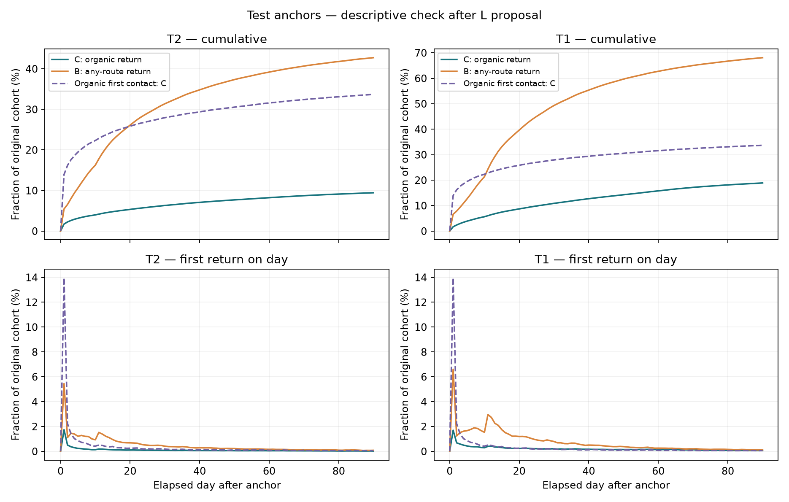
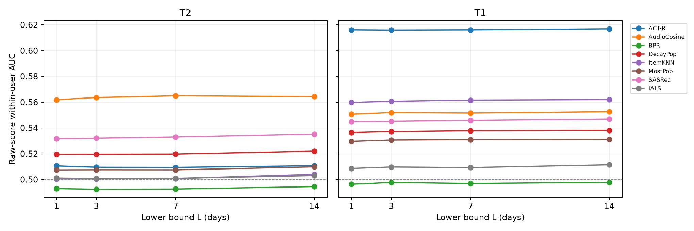

# Organic Relistening after Recommendation: a Benchmark on Yambda-50M

[日本語版 README](README.ja.md)

When a recommender plays a song a user has never heard, does the user come back to it **on their own** later?
This repository builds that question into a benchmark on [Yambda-50M](https://huggingface.co/datasets/yandex/yambda) and evaluates eight existing recommenders on it under one protocol.
No new model is proposed. The contribution is the problem framing, the benchmark, and what the comparison shows about current objectives and metrics.

## TL;DR

- On first-time recommended songs (task T2), the best existing model predicts a later organic relisten with a **within-user AUC of 0.562** (AudioCosine; 95% CI 0.557–0.567). Collaborative filtering (iALS, ItemKNN) cannot be distinguished from chance (0.5).
- **No agreement was found between next-item accuracy and organic relistening.** We could not detect agreement between the model ranking by NDCG@10 and the ranking by organic relisten AUC (Kendall τ = −0.29, p = 0.40, 8 models). iALS ranks 1st on NDCG and 6th on organic relisten. AudioCosine ranks last and 1st.
- **Route-agnostic labels make models trained on all plays look better.** On the same pairs and users, counting any relisten (including ones the recommender played again) instead of organic ones raises the AUC of SASRec, BPR and iALS in all four settings we checked. For SASRec on T2 the gain is +0.036 (95% CI 0.032–0.040).
- **Likes miss most of the returns users make on their own.** Of T2 test tracks that were relistened organically, 57.7% have no like recorded before the anchor or within 90 days after it (post-hoc analysis).
- **Pooled (global) AUC mostly measures who comes back, not which song.** A per-user base rate alone reaches a global AUC of 0.608 on T2, higher than any model's raw score.
- Results hold for label windows starting at 1, 3, 7 or 14 days: the top three models on T2 keep their order.

## 1. Problem: what current objectives and metrics miss

Music recommenders are usually trained and evaluated on whether the user plays the next item (Recall, NDCG on held-out listens).
A play that follows a recommendation does not tell us whether the user liked the song or was only exposed to it.
A stronger signal of value is whether the user returns to the song **through their own choice** (search, library, own playlist) later on.

Explicit likes are not enough. Among test tracks that were relistened organically, 57.7% on T2 and 75.2% on T1 have no like recorded either before the anchor or within 90 days after it. A like-based label would miss most of the returns users make on their own ([Supplementary: relation to likes](#supplementary-relation-to-likes-added-after-results-definitions-recorded-before-running)).

We identify four gaps in standard practice and measure each one.

| Gap | What goes wrong | Evidence in this study |
| --- | --- | --- |
| Objective: next-item accuracy | It rewards predicting any play, including plays the recommender itself causes. | No agreement was detected between model rankings by NDCG@10 and by organic relisten (Finding 3). |
| Label: explicit likes | Organic returns that come without a like are not counted. | 57.7% of organic relistens on T2 come without a like (supplementary, post-hoc). |
| Label: relisten regardless of route | Re-exposure by the recommender counts as a "return". | Models trained on all plays score higher on route-agnostic labels than on organic ones (Finding 4). |
| Metric: pooled AUC | Users differ strongly in how often they return, so pooled AUC rewards predicting the user, not the song. | A per-user base rate alone reaches global AUC 0.608 on T2. We therefore use within-user AUC. |

## 2. The benchmark

### Source data

Yambda-50M (Yandex, Apache-2.0): 46,467,212 listens by 9,238 users over 877,168 tracks across about 301 days.
Every listen carries an `is_organic` flag: 0 = played by the recommender, 1 = chosen by the user.
About 51.7% of listens are organic.

### Tasks

Each instance is an **anchor**: a recommendation-driven listen (`is_organic = 0`) of track *i* by user *u*.

- **T2 (main): first contact.** The user had never played the track before the anchor.
- **T1 (auxiliary): known track.** The user had played the track before.

### Labels

- **C, organic relisten (main):** the user plays the same track organically between **24 hours and 90 days** after the anchor (both ends inclusive). Relistens within 24 hours are not counted. The 24-hour lower bound was fixed for conceptual reasons before any model result was seen.
- **B, relisten by any route:** same window, any route. Used only to measure how route-agnostic labels change conclusions.
- **Cohort:** users with at least 30 active days within the same window. The results therefore describe users who kept using the service.

### Temporal split

Days are calendar-day indices (`timestamp // 86400`).
Models are trained on listens up to day 149 and evaluated on pairs anchored on days 165–210 (test).
Features use only history before the anchor, and the label window uses only the future. Tests check window boundaries, invariance to future history, and the metrics.

Test size: T2 has 967,884 pairs (4,819 users, C positive rate 9.6%, B positive rate 43.2%). T1 has 982,716 pairs (4,485 users, 19.3%, 68.7%).

Pairs anchored on days 150–164 are kept as a validation split but are not used for tuning. Pairs anchored on days 30–59, scored by models trained up to day 29, are used only to choose the label-window lower bound and for secondary and auxiliary analyses (a shared logistic head, the end-to-end model and others). Scoring those pairs with day-149 models would put their target relistens into the models' training data, so the cutoffs are kept separate.

B and C differ sharply (43% vs 10% on T2 test): most route-agnostic "returns" happen only because the recommender played the song again.



*Test anchors. Teal: organic return (C). Orange: return by any route (B). Dashed: organic return after an organic first listen, for reference.*

The labeled pair table (`pairs.parquet`, 154 MB) is not committed. `notebooks/00_data.ipynb` and `01_labels_splits.ipynb` rebuild it deterministically. Source revisions and SHA256 hashes are checked during download.

## 3. Models and protocol

| Model | Family | Source |
| --- | --- | --- |
| MostPop | Popularity | Yambda official baselines |
| DecayPop | Time-decayed popularity | Yambda official baselines |
| ItemKNN | Item-item collaborative filtering | Yambda official baselines |
| iALS | Matrix factorization (implicit) | Yambda official baselines |
| BPR | Matrix factorization (pairwise) | Yambda official baselines |
| SASRec | Sequential transformer | Yambda official baselines |
| ACT-R | Memory model (recency × frequency), a standard relisten predictor | Added |
| AudioCosine | Cosine similarity between the track's audio embedding and the user's organic-listen profile | Added |

- **Primary metric:** within-user ROC-AUC of each model's raw score (oriented so that higher means a better match). Users are weighted equally. 95% intervals come from a user-level bootstrap with 1,000 resamples.
- **Hyperparameters:** each model follows its official search, tuned on its own next-item NDCG with the last day before the model cutoff as validation. The relisten labels are never used for tuning. SASRec uses the official fixed configuration. iALS and BPR are averaged over three seeds. The other models use one seed.
- **Scoring inputs:** iALS, BPR, ItemKNN, MostPop and DecayPop are frozen at the model cutoff (day 149) and do not see later history. SASRec, ACT-R and AudioCosine use the history up to just before each anchor. SASRec uses only plays with a played ratio of at least 50%, and appends the anchor track when the anchor play itself reaches 50%. Users or tracks unknown at the cutoff get each model's minimum score.
- **SANSA** (in the plan) was not run. The official 50M recipe needs more than 100 GB of memory, and the machine has 24 GB. No reduced version was substituted.

## 4. Results

### Main result: organic relisten, test, L = 1 day

| Model | T2 (first contact, main) | T1 (known track) |
| --- | --- | --- |
| AudioCosine | **0.562** (0.557–0.567) | 0.551 |
| SASRec | 0.532 (0.527–0.537) | 0.545 |
| DecayPop | 0.520 | 0.536 |
| ACT-R | 0.511 | **0.616** (0.611–0.621) |
| MostPop | 0.507 | 0.530 |
| iALS | 0.501 (0.496–0.505) | 0.509 |
| ItemKNN | 0.500 (0.496–0.505) | 0.560 |
| BPR | 0.493 (0.488–0.497) | 0.496 |

T2 test: 967,884 pairs, 4,124 users with both labels. T1 test: 982,716 pairs, 3,953 users.

### Finding 1: existing models predict organic relistening of new songs only weakly

The best T2 AUC is 0.562. The 95% intervals of iALS and ItemKNN include 0.5, and BPR is slightly below it.
The paired differences among the top three models exclude zero: AudioCosine − SASRec = +0.030 (0.023–0.038), SASRec − DecayPop = +0.012 (0.008–0.016).
These pairs were chosen after seeing the test ranking, and no multiple-comparison correction was applied.

### Finding 2: what works depends on whether the song is new

- On **new songs (T2)**, similarity to the user's own taste in audio (AudioCosine) works best.
- On **known songs (T1)**, memory (recency and frequency, ACT-R) works best: ACT-R − ItemKNN = +0.056 (0.050–0.063).
- Within T2, the winner changes by condition (`results/rq3_summary.csv`). Among tracks with a popularity signal, SASRec has the highest point estimate in every popularity quartile. On tracks with no popularity signal (20.2% of T2 test pairs), all collaborative, sequential and popularity models sit at 0.500, and only AudioCosine is above chance (0.590). This is consistent with AudioCosine's overall lead, but we did not estimate how much of the lead comes from this stratum.

### Finding 3: no agreement detected between next-item accuracy and organic relistening

| | Kendall τ (A vs C) | p |
| --- | ---: | ---: |
| T2, all pairs | −0.29 | 0.40 |
| T1, all pairs | −0.14 | 0.72 |
| T2, tracks seen in training only | +0.07 | 0.90 |

A is NDCG@10 on a temporal holdout: trained on days ≤ 149, every track played on days 150–210 counts as relevant.
With 8 models this does not show that the two are unrelated. It shows that agreement could not be detected.
B vs C, in contrast, agrees (τ = 0.64, p = 0.03).

### Finding 4: route-agnostic labels make models trained on all plays look better

Paired difference AUC(B) − AUC(C), on the same pairs and the same users:

| Model | T2 all | T2 seen tracks | T1 all | T1 seen tracks |
| --- | ---: | ---: | ---: | ---: |
| SASRec | +0.036 | +0.033 | +0.056 | +0.053 |
| BPR | +0.017 | +0.010 | +0.042 | +0.040 |
| iALS | +0.015 | +0.005 | +0.036 | +0.034 |
| AudioCosine | +0.007 | +0.012 | +0.006 | +0.006 |
| ACT-R | +0.005 | +0.012 | **−0.011** | **−0.011** |

For SASRec, BPR and iALS the difference is positive in all four settings, and every 95% interval excludes zero.
This is consistent with these models partly predicting what the recommender will play again.
ACT-R on T1 is the only case where organic relistening is predicted better.
B and C are different labels, so the difference alone does not measure the size of an evaluation bias or the causal effect of re-recommendation.

### Finding 5: cold tracks drive part of the ranking

Collaborative and sequential models give every track unseen in training the same minimum score (20–33% of T2 test pairs), which pulls their AUC toward 0.5.
When T2 is restricted to tracks that appear in the training log (783,315 pairs), the order changes: SASRec 0.586, DecayPop 0.571, MostPop 0.546, AudioCosine 0.545.
Collaborative filtering then rises clearly above 0.5 too, so it does carry some signal about retention.
We therefore report both views: all pairs (performance when deployed on new songs too) and seen tracks (performance within the model's own catalogue).

### Other checks

- **Lower bound of the label window:** L = 1, 3, 7, 14 days keep the T2 top three in the same order (AudioCosine 0.562–0.565, SASRec 0.532–0.535, DecayPop 0.520–0.522).

  
- **Training SASRec directly on label C** (end-to-end, auxiliary): it fit training pairs (AUC 0.823) but reached only 0.481 on test. Two factors were observed: 38.5% of test pairs fell outside the frozen day-29 vocabulary, and a large train–test gap remained within the vocabulary (0.924 vs 0.536). This covers one recipe only (10 epochs, one seed, frozen vocabulary).

### Supplementary: relation to likes (added after results; definitions recorded before running)

Using Yambda's like log (`likes.parquet`), we ran two checks on the main pairs (L = 1, test). Unlikes are not taken into account. Pairs whose track the user had already liked before the anchor form a separate group (prior like). Results are in `results/like_analysis/REPORT.md`.

**Likes and organic relistening (P13).** Tracks liked within 90 days of the anchor are much more often relistened organically.

| Task | Liked | Not liked | Within-user difference (95% CI) |
| --- | ---: | ---: | --- |
| T2 | 76.6% | 5.9% | +75.5 points (74.4–76.8) |
| T1 | 80.9% | 15.6% | +67.3 points (66.2–68.5) |

Most organic relistens, however, happen without a like (57.7% of test C positives on T2 and 75.2% on T1 have no like recorded before the anchor or within 90 days after it). A like-based label would miss most of the returns users make on their own.
A liked track enters the user's library, which may make organic replays easier. Yambda does not record which organic entry point was used, so we do not read this as a causal effect or as validation of preference.

**Likes as an auxiliary label D (P14).** With the same raw scores, we predicted "liked within 90 days" on pairs without a prior like.
On T2 only AudioCosine (0.559), SASRec (0.515) and ACT-R (0.510) exceed 0.5. iALS, BPR, ItemKNN and MostPop fall below 0.5, with intervals excluding it.
Model rankings agree between D and C (T2 τ = 0.79, p = 0.006). No agreement was detected between D and next-item accuracy A (τ = −0.21, p = 0.55). Restricted to tracks seen in training, the D–C agreement drops to τ = 0.36 (p = 0.28).

## 5. What the results support

**Supported**

1. In this setting, existing recommenders predict organic relistening of newly recommended songs only weakly (best within-user AUC 0.562).
2. Being strong at next-item prediction does not imply being strong at predicting organic relistening.
3. Evaluating on relisten-by-any-route favours models trained on all plays.
4. Restricting to tracks seen in training reorders models, so cold-item handling is part of what this benchmark measures.

**Not supported**

- That organic relistening equals user satisfaction or "true value". It has not been validated against subjective judgments, so it is a proxy.
- Any causal claim that recommendation produces retention.
- That next-item accuracy and organic relistening are unrelated (8 models only).
- That models cannot learn this target directly (one end-to-end recipe, one seed).
- Generalisation beyond active users (cohort: 30 or more active days) and beyond Yambda-50M.

## 6. Pre-registered vs post-hoc

| Status | Analyses |
| --- | --- |
| Planned before results | Model comparison, label-window sensitivity, A/B/C ranking frame, end-to-end frame, conditional analysis (strata named in advance; boundaries set by test quartiles) |
| Changed after results, recorded before re-aggregation | Primary metric moved from AUC through a shared logistic head to raw-score AUC (reasons in DECISIONS.md; old tables in `results/superseded_head_primary/`) |
| Added after results | Seen-track restriction, paired B − C, top-model paired differences, ACT-R component diagnostics, end-to-end diagnostics, 7-day activity diagnostic, relation to likes (P13, P14; definitions recorded before running) |

All post-hoc analyses also ran on the test split. Per-decision notes with dates are in [DECISIONS.md](DECISIONS.md) (Japanese).

### Deviations from the original plan

- Main label window changed from 8–90 days (L = 7) to 24 hours–90 days (L = 1), before model results.
- Train scores come from day-29 models instead of day-149 models, to prevent leakage.
- SANSA dropped for memory (see above), so 8 models instead of 9.
- NDCG uses the standard DCG/IDCG. The official implementation has a normalisation bug, so the numbers are not directly comparable to the official ones.
- The implementation guide said to multiply `timestamp` by 5. The raw value is already in seconds (5-second bins), so we did not.

## 7. Limitations

- Users are selected by future activity (30 or more active days in the window).
- The secondary metrics and the end-to-end model are fit on scores from day-29 models, which see less data than the day-149 evaluation models.
- ACT-R is weak at the pair level on T2. Its spreading-activation term is exactly zero for 86% of pairs. We did not separate the contributions of candidate-set normalisation, float32 precision and extreme lift.
- Single seed for every model except iALS and BPR. Intervals and p-values are not corrected for multiple comparisons.
- One dataset: Yambda-50M.

## 8. Repository layout

```
src/relisten/      labels, splits, models, metrics, evaluation (importable package)
notebooks/         numbered pipeline; run top to bottom in order
results/           all result tables (CSV/JSON) and per-stage reports (Markdown, Japanese)
tests/             35 tests: window boundaries, leakage invariance, metrics, resumption
docs/paper1.md     research plan as of 2026-10-16 (Japanese; pre-registration snapshot)
docs/results_factsheet.md   every reported number traced to a CSV row (Japanese)
DECISIONS.md       dated implementation decisions and verification notes (Japanese)
```

Key result files: `results/main_test_results.csv` (main table), `results/all_model_results.csv` (L sensitivity), `results/rq3_summary.csv` (conditional analysis), `results/seen_item_auc_comparison.csv` and `results/abc_rank_summary.csv` (seen tracks, A/B/C), `results/paired_b_minus_c.csv` (Finding 4), `results/sasrec_end_to_end_metrics.csv` (end-to-end), `results/like_analysis/` (likes, P13 and P14).

## 9. Reproduce

Python 3.11 or newer. Pinned versions are in `requirements.lock`.

```sh
uv venv --python 3.13 .venv
uv pip sync --python .venv/bin/python requirements.lock
uv pip install --python .venv/bin/python --no-deps -e .
.venv/bin/python -m ipykernel install --prefix .venv --name paper1 --display-name 'Paper 1 (.venv)'
.venv/bin/python -m pytest -q
```

Then run the notebooks in order with the `Paper 1 (.venv)` kernel:

1. `00_data` downloads Yambda-50M listens and likes plus the audio embeddings for the tracks that appear in 50M (HTTP range reads), and verifies SHA256.
2. `01_labels_splits` builds the T1/T2 pairs, the C/B labels and the splits.
3. `02_eda` runs the label-window EDA on the training split only.
4. `03_light_baselines` covers MostPop, DecayPop, ACT-R and AudioCosine. `03b_actr_components` holds the ACT-R diagnostics.
5. `04_itemknn`, `04_ials`, `04_bpr`, `04_sansa` (records the memory limit) and `04_sasrec` train and score one model each. Run them one at a time, not in parallel.
6. `04z_score_protocol` computes the raw-score AUC (primary) and the head-based secondary metrics.
7. `05_aux_analysis`, `05b_seen_items_and_rank_summary` and `05c_paired_routes` produce the A/B/C rankings, conditional analysis, seen-track restriction and paired B − C.
8. `06_end_to_end` trains SASRec directly on label C (auxiliary).
9. `07_like_analysis` runs the post-hoc like analyses (P13, P14).

`scripts/run_notebooks.py` runs the notebooks headlessly and saves them in place. iALS, BPR and SASRec checkpoint and resume after interruption.
Reference hardware: Apple Silicon Mac mini with 24 GB RAM, no CUDA. SASRec uses PyTorch MPS.
`data/` (about 6 GB after processing) is not committed.

## Data and license

Data: [Yambda](https://huggingface.co/datasets/yandex/yambda) by Yandex, Apache-2.0. Only the 50M subset is used.
